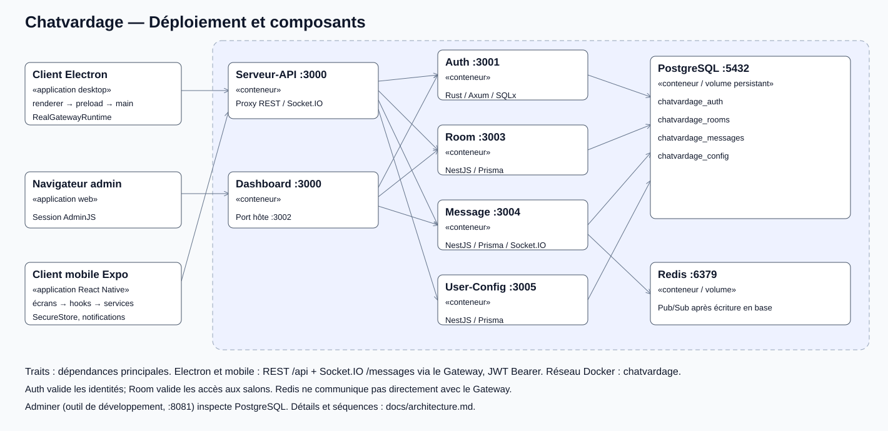
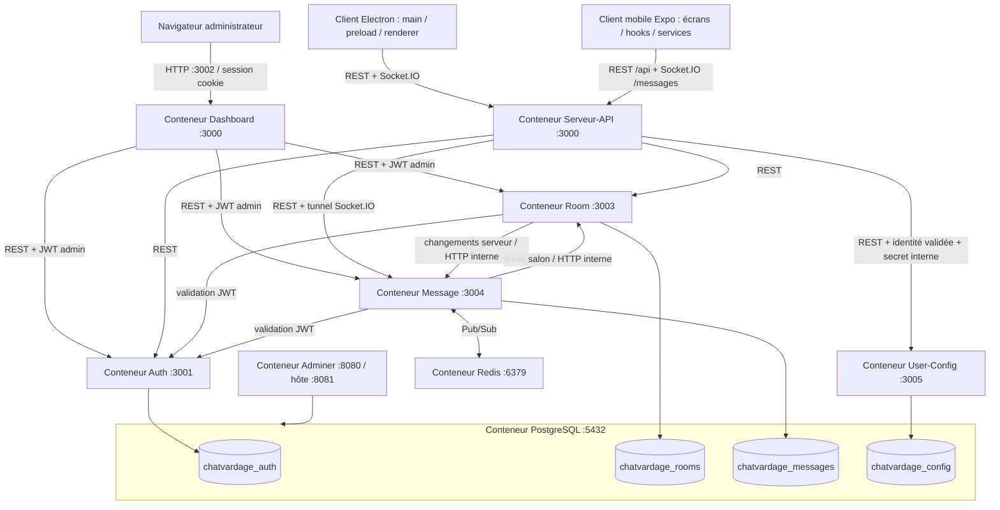
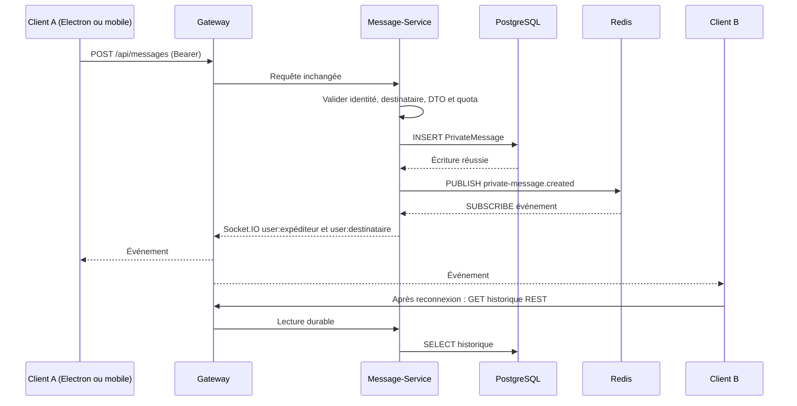

# Architecture

## Applications, conteneurs et protocoles

Le Gateway ne se connecte jamais à Redis. Le Dashboard appelle directement les services sur le réseau Docker; ses autorisations sont vérifiées par Auth et les services propriétaires. Tous les conteneurs sont sur le réseau `chatvardage`; PostgreSQL et Redis disposent de volumes persistants. Le navigateur, Electron et l’application mobile vivent hors des conteneurs.

## Pourquoi cette architecture

La séparation suit les responsabilités et le travail d’équipe : Auth possède les identités, Room les permissions par serveur, Message les historiques et événements, Config les préférences. NestJS/TypeScript mutualise les conventions DTO/tests de trois services et du Gateway; Rust/Axum isole l’authentification derrière le même contrat HTTP. PostgreSQL assure les données durables; Redis Pub/Sub transporte les événements éphémères; Socket.IO gère la diffusion aux clients. Prisma versionne les migrations, y compris Auth qui utilise SQLx au runtime. Docker Compose assemble un environnement local reproductible.

Cette séparation exige davantage d’appels et de contrats qu’un monolithe : elle est un choix d’organisation, pas une condition du barème. Le déploiement est mono-instance par service.

## Séquence d’un DM

Une publication Redis échouée n’annule pas l’écriture PostgreSQL : la requête réussit, au plus 4 s plus tard, et Message-Service journalise la publication perdue. Redis Pub/Sub ne rejoue pas les événements manqués : chaque client (Electron et mobile) relit l’historique par REST après `connexion.prete`. Les doublons visuels sont fusionnés par identifiant. Les messages de salon sont également persistés et diffusés en temps réel.

## Configuration et rôles

Les configurations sont écrites/lues en REST dans User-Config. Le processus principal Electron applique les préférences et les diffuse aux vues par IPC. Les changements de profil public sont annoncés après enregistrement; les données restent relues par REST.

`admin` est un rôle global. Les rôles propriétaire/modérateur/membre des serveurs sont gérés par Room-Service : il n’existe pas de modérateur global, Authentification ne connaît que `admin` et `utilisateur`. Les routes internes exigent `x-internal-token` et ne sont pas relayées publiquement par le Gateway.

## Limites et exploitation

- Services mono-instance; aucune garantie de reprise durable des événements Redis.
- Sessions/rate limits et certaines présences conservés en mémoire.
- Suppressions interservices notifiées avec tentatives bornées; un échec définitif est journalisé.
- Ce Compose utilise HTTP sur un réseau local et des identifiants de développement. Passer `NODE_ENV=production` seul ne fournit ni TLS ni gestion de secrets : un déploiement de production exige une configuration dédiée.
- [Bases et migrations](database.md), [client desktop](architecture-frontend.md), [client mobile](https://github.com/Chatvardage/A26_5A6_01-Mobile/blob/develop/docs/architecture.md), [contrats](api/README.md).
